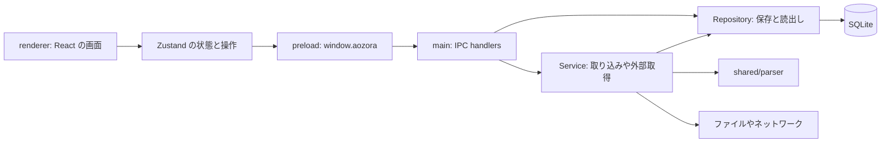
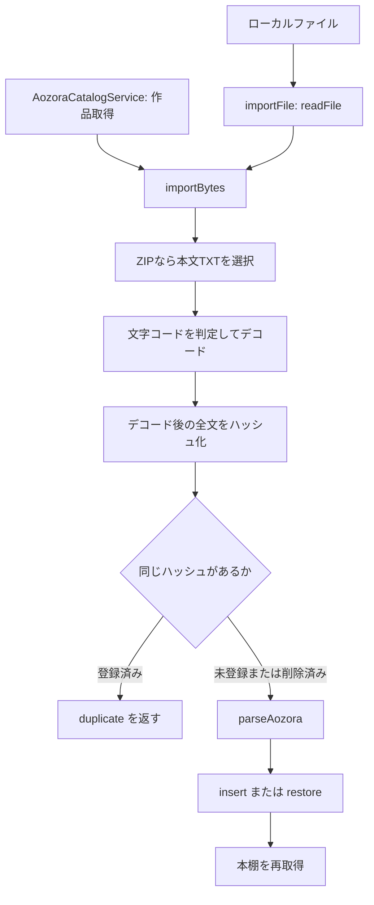
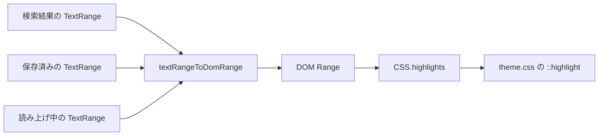

# 青空Reader コード読解指南書

このアプリは、青空文庫のテキストを構造化して保存し、その本文を縦書きや横書きで読むデスクトップアプリです。
コードを理解する軸は、**本文の構造**と**本文中の位置**の二つです。
取り込み、表示、検索、注釈、読み上げが、この二つをどのように受け渡すかを追うと、各ファイルの役割がつながります。

JavaScript の関数、配列、オブジェクトを読めることを前提にしています。
TypeScript、React、Electron に固有の用語は、必要になる場所で説明します。
最初は第1〜4節を読み、実装を開きながら第5節以降へ進む使い方を想定しています。

調査基準は2026年9月15日の作業ツリー（HEAD: `c4875ad`）です。
説明は現在の実装を基準とし、コメントに書かれた将来構想とは区別しています。
ソース中の「要件 §…」は既存コメントの参照番号であり、この指南書の節番号とは対応しません。
ソースへのリンクは、`docs/CODE_GUIDE.md` を基準にした相対パスです。
リポジトリを別の場所へ移動しても、同じファイルを開けます。
目次にある `#8-検索とハイライトの共通部分` のようなリンクは、同じ指南書内の見出しへ移動するアンカーです。
これはファイルパスではないため、絶対パスにはしません。

## 目次

1. [最初に読むファイル](#1-最初に読むファイル)
2. [プロセスと責務の境界](#2-プロセスと責務の境界)
3. [本文を表すデータ構造](#3-本文を表すデータ構造)
4. [位置をページ番号で保存しない理由](#4-位置をページ番号で保存しない理由)
5. [ファイルの取り込みを追う](#5-ファイルの取り込みを追う)
6. [作品を開いて本文を表示する](#6-作品を開いて本文を表示する)
7. [ページ送りと位置復元](#7-ページ送りと位置復元)
8. [検索とハイライトの共通部分](#8-検索とハイライトの共通部分)
9. [設定と非同期処理の読み方](#9-設定と非同期処理の読み方)
10. [読み上げと読書時間](#10-読み上げと読書時間)
11. [テストを使った読解](#11-テストを使った読解)
12. [変更したい機能から実装を探す](#12-変更したい機能から実装を探す)
13. [理解を確かめる練習](#13-理解を確かめる練習)

## 1. 最初に読むファイル

最初の一巡では、長い画面コンポーネントの全行を理解する必要はありません。
まずデータの型を読み、次に一つの操作を入口から保存先まで追います。

| 順番 | 読むファイル | 読み取ること |
|---|---|---|
| 1 | [document.ts][document] | 作品、章、段落、ルビがどのデータに対応するか |
| 2 | [position.ts][position] | 本文中の位置と範囲をどう表すか |
| 3 | [ipc.ts][ipc] | 画面が main に頼める操作は何か |
| 4 | [ImportService.ts][importer] | ファイルから `Book` を作る流れ |
| 5 | [BookRepository.ts][books] | `Book` の保存形式と読み出し方 |
| 6 | [useReaderStore.ts][reader-store] | 作品を開いたときに保持する状態 |
| 7 | [ReaderView.tsx][reader] | 表示、移動、保存を接続する場所 |
| 8 | [contract.ts][contract] と [positionMapping.ts][mapping] | 本文中の位置を画面上の文字へ対応させる方法 |
| 9 | [LayoutController.ts][layout] | 文字の表示位置からページを求める方法 |

初回は `ReaderView` の `next`、`syncPosition`、`goToPosition` を探すだけでも構いません。
位置の受け渡しが読めたら、設定変更に反応する `useLayoutEffect` と選択処理の `captureSelection` へ進みます。

## 2. プロセスと責務の境界

Electron は、OS に近い処理を行う **main プロセス**と、画面を描く **renderer プロセス**を分けます。
このアプリでは、その間を **preload**（画面に公開する関数を用意するスクリプト）がつなぎます。
`shared` は両側から参照するコードの置き場であり、独立したプロセスではありません。



**IPC** は、プロセスをまたいで処理を依頼する仕組みです。
たとえば画面が `window.aozora.openBook(bookId)` を呼ぶと、preload が `ipcRenderer.invoke('openBook', bookId)` を送り、main の同名ハンドラーが作品を読み出します。
結果は `Promise`（あとで返る結果を表すオブジェクト）として画面へ戻ります。

### 起動時に通る入口

| 入口 | 起動時の役割 |
|---|---|
| [src/main/index.ts][main] | DB とサービスを初期化し、IPC を登録し、ウィンドウを作る |
| [src/preload/index.ts][preload] | `IPC_CHANNELS` の操作を `window.aozora` に公開する |
| [src/renderer/main.tsx][renderer-main] | React のルートを作り、`App` を表示する |
| [App.tsx][app] | 設定とフォントを読み、本棚と読書画面を切り替える |

main の起動順は `app.whenReady()` → `initServices()` → `registerIpc()` → `createWindow()` です。
DB の保存先は `app.getPath('userData')` 配下の `library.db` で、リポジトリ内には作りません。
追加フォントも同じユーザーデータ領域の `fonts` に保存します。

### 依存関係を読むための用語

- **Service**：取り込みやカタログ取得など、一連の処理をまとめるクラスです。
- **Repository**：DB の行を読み書きし、アプリのオブジェクトへ変換するクラスです。
- **DTO**：IPC などの受け渡し用に整えたデータです。
  たとえば取り込み結果では、詳しい `ParseIssue[]` を `issueCount` に変換して画面へ返します。
- **store**：画面の状態と、その状態を変更する操作をまとめたものです。
  このアプリでは Zustand を使っています。

renderer は `fs` や SQLite を直接呼びません。
ウィンドウ設定は `contextIsolation: true`、`nodeIntegration: false` で、公開する操作を preload に集めています。
一方、`sandbox` は `false` です。
プロセス分離の説明と、Electron の sandbox 設定は区別して読みます。

Repository が主に SQL を担当しますが、[SearchService.ts][search] は検索用 SQL を直接実行します。
「Service に SQL は一切ない」という規則として読むと、実装と食い違います。

## 3. 本文を表すデータ構造

[document.ts][document] の **Document Model** は、元の青空文庫記法を表示しやすい形に変換したデータです。
型の階層は次のようになります。

```text
Book                       作品の情報と本文全体
└─ chapters: Chapter[]     章の配列
   └─ blocks: Block[]      段落、見出し、改ページなど
      ├─ plainText         本文中の位置を数える文字列
      └─ children          文字、ルビ、傍点などの InlineNode[]
```

本棚では本文を含まない `BookSummary` を使います。
作品を開いたときに `Book` を読み込み、renderer は現在の章の `blocks` を描画します。
つまり、読書中は作品全体のモデルを保持し、画面の DOM は章単位で用意します。

### ルビを含む一行の例

入力が次の一行だとします。

```text
吾輩《わがはい》は猫である。
```

パーサーは、これを次のように分けます。
表ではブロックの ID などを省略しています。

| データ | 値 |
|---|---|
| `plainText` | `吾輩は猫である。` |
| 最初のノード | `{ kind: 'ruby', start: 0, end: 2, baseText: '吾輩', rubyText: 'わがはい' }` |
| 次のノード | `{ kind: 'text', start: 2, end: 8, text: 'は猫である。' }` |

`plainText` は8文字分の長さを持ち、読みの「わがはい」は含みません。
検索も位置計算もこの文字列を使い、表示するときだけ `rubyText` を添えます。
そのため「吾輩」はこの行に一致しますが、「わがはい」はこの行の本文検索には一致しません。

`start` と `end` は **半開区間** `[start, end)` を表します。
開始位置を含み、終了位置を含まないので、`plainText.slice(start, end)` で対象文字列を取り出せます。
上のルビなら `plainText.slice(0, 2)` が `吾輩` になります。

### 型の分岐と入れ子

`InlineNode` は `kind` によって形が変わる型です。
TypeScript は `switch (n.kind)` の各分岐で、利用できるプロパティを絞り込みます。
`ruby` の分岐では `n.rubyText` を読めますが、`text` の分岐にはそのプロパティがありません。

傍点、太字、傍線のノードは `children` を持ちます。
ルビの付いた文字に傍点を付ける場合も、この入れ子で表せます。
[InlineRenderer.tsx][inline-renderer] は入れ子を再帰的に読み、装飾を引き継いで描画します。

### 三種類のオフセット

| フィールド | どこを起点にするか | 主な用途 |
|---|---|---|
| `InlineNode.start/end` | そのブロックの `plainText` の先頭 | 行内の文字範囲 |
| `Block.charStart` | 章の先頭 | 章内の累積文字数 |
| `Chapter.charStart` | 作品の先頭 | 作品全体の累積文字数 |

`Block.sourceStart/sourceEnd` は、パーサーが改行などを正規化した入力上の診断用オフセットです。
注記やルビの記法も数えるため、読書位置には使いません。

## 4. 位置をページ番号で保存しない理由

フォントを大きくすると、一つの画面に入る文字数が減ります。
同じ文章が別のページに移るため、保存位置を「12ページ」としておくと、表示条件を変えたあとに別の文章へ戻ってしまいます。

このアプリの **TextPosition** は、作品、章、ブロック、ブロック内オフセットを保存します。

```ts
interface TextPosition {
  bookId: string
  chapterId: string
  blockId: string
  offset: number
}

interface TextRange {
  start: TextPosition
  end: TextPosition
}
```

前節の「猫」は、`plainText` の `[3, 4)` にあります。
実際の作品 ID、章 ID、ブロック ID に `offset: 3` を組み合わせれば、表示条件によらず同じ位置を指せます。
現在の表示条件で何ページになるかは、画面を組んだあとで計算します。

### UTF-16 の長さを使う

オフセットの単位は **UTF-16 コードユニット**です。
JavaScript の文字列の `length` と、DOM のテキストノード内のオフセットが使う単位です。
次の二つは値が異なります。

```js
'𠀋'.length       // 2
[...'𠀋'].length  // 1
```

このアプリの位置計算には前者を使います。
後者の数え方を途中で混ぜると、その文字より後ろの検索結果や選択範囲がずれます。
「字数」と表示している値も、実装上は原則として `plainText.length` の合計です。

### 読了率の計算

[position.ts][position] の `buildBookIndex(book)` は、ブロック ID からブロックと章を引く `Map` などを作ります。
その索引を `positionToCharOffset` や `positionToPercentage` で使います。

```text
作品先頭からの位置
  = Chapter.charStart + Block.charStart + offset

読了率
  = 作品先頭からの位置 / Book.totalCharacters
```

実装ではオフセットを範囲内へ丸め、空の作品では読了率を0にします。
段落間の改行をこの累積文字数へ加える処理はありません。
一方、`extractRangeText` は、複数ブロックの文章をコピーしやすくするために改行で連結します。
コピーした文字列の長さと、作品全体の位置の差は、ブロックをまたぐ場合には一致しないことがあります。

### ID の安定性が成り立つ範囲

パーサーは `c0`、`c0_b0` のように順序から章とブロックの ID を作ります。
通常の作品オープンでは保存済みのモデルを読み込むため、パーサーの変更が既存作品の ID に影響しません。

ただし、本文を削除してから再取り込みする場合は再パースします。
同じ入力でも、章の分け方や空行の扱いを変えれば ID が変わる可能性があります。
「同じテキストなら、どのパーサーバージョンでも位置が一致する」という保証ではありません。

## 5. ファイルの取り込みを追う

ファイルを追加する入口は、ファイル選択ダイアログ、本棚へのドラッグ＆ドロップ、公式カタログからの取得です。
ローカルファイルは `ImportService.importFile` を通り、最終的には `importBytes` に処理が集まります。



### 変換処理の担当

| 担当 | 入力と出力 | 読む際の注意 |
|---|---|---|
| [zip.ts][zip] の `readAozoraZip` | ZIP → 本文のバイト列と画像一覧 | TXT が複数ある場合は最大サイズを本文とみなす |
| [decode.ts][decode] の `decodeAozoraText` | バイト列 → テキストと文字コード | UTF-8 BOM、厳密な UTF-8、Shift_JIS の順に判定する |
| [hash.ts][hash] の `hashText` | テキスト → SHA-256 | ファイル名や作品名ではなく、デコード後の全文で重複を調べる |
| [parser/index.ts][parser] の `parseAozora` | テキスト → ヘッダー、章、診断情報 | 凡例と奥付を分け、本文の各行を処理する |
| [parser/inline.ts][inline-parser] の `parseInline` | 一行 → 本文、行内ノード、ブロック指示 | ルビ、外字、装飾を解釈する |
| [annotation.ts][annotation-parser] の `classifyAnnotation` | 注記の文字列 → 注記の種類 | 対応記法を増やす際の入口 |

ハッシュ化は `parseAozora` の改行正規化より前です。
したがって、表示される本文が同じでも、改行コードや奥付の違いで別のハッシュになる場合があります。

未知の注記は、`start === end` の幅を持たない `note` ノードとして保持します。
問題は `ParseIssue` に集め、扱える本文を残す方針です。
これに対し、解決できない外字は代替文字などを `plainText` に入れるため、未知の注記とは位置の扱いが異なります。

### SQLite に二つの本文表現を持つ理由

[BookRepository.writeContent][books] は、表示用と検索用の本文を一つのトランザクションで保存します。
**トランザクション**は、複数の書き込みを一括で確定し、途中で失敗した場合に取り消す単位です。

| テーブル | 保存内容 | 利用する処理 |
|---|---|---|
| `books` | 書名、著者、ハッシュ、総文字数など | 本棚、重複判定 |
| `chapters` | 章の情報と `blocks_json` | 作品を開く際のモデル復元 |
| `blocks` | 空でないブロックの `plain_text` と順序 | 本文検索、ハイライトの復旧 |
| `reading_progress` | 最後の本文位置、読了率、読了状態 | 読書位置の再開 |
| `bookmarks` / `highlights` / `notes` | 栞、色付き範囲、メモ | 注釈の保存と一覧 |
| `settings` | JSON 値を持つ設定キー | アプリ設定と読書設定 |
| `reading_sessions` | 開始と終了の位置、時間、移動文字数 | 読書時間の集計 |

`chapters.blocks_json` にはルビや装飾を含む構造を残します。
`blocks.plain_text` は検索に使いやすい文字列です。
表示と検索を変更するときは、この二つをどちらも更新する `writeContent` の役割を確認します。

DB の初期化とバージョン管理は [connection.ts][db] と [migrations/index.ts][migrations] にあります。
`PRAGMA user_version` を読み、未適用の SQL を順番に実行します。
現在のマイグレーションは、初期テーブルを作るバージョン1と、メモ範囲やセッション位置を追加するバージョン2です。
`book_settings` テーブルも定義されていますが、現在の設定 API はグローバル設定を読み書きします。

### 削除と復元

`BookRepository.delete(bookId, true)` は本文を削除し、`books.deleted_at` を立てて本棚から隠します。
作品の行を残すので、注釈や進捗も残ります。
同じハッシュの原本を再取り込みすると、`restore` が本文を入れ直します。

`keepUserData` が `false` の場合は作品の行も削除します。
関連テーブルは `ON DELETE CASCADE` によって削除されます。
この二つの操作は、名前の違いだけでなく、保存データの残り方が異なります。

### 実装されている取り込みの範囲

ZIP の読み取り関数は画像一覧を返しますが、`ImportService` が使うのは本文の `main.bytes` です。
[BlockRenderer][block-renderer] の画像ブロックも、現在は代替表示を描きます。
画像型が存在することと、挿絵の保存から表示までが実装済みであることは別です。

文字コードを指定する `importWithEncoding` API はあります。
ただし、現在の本棚 store は `needs-encoding` を通知にまとめるところまでで、文字コードを選んで再試行する画面はつながっていません。

## 6. 作品を開いて本文を表示する

本棚で作品を選んだときは、[App.tsx][app] の `onOpen` から追います。

1. `App` が表示を `reader` に切り替え、`reader.open(bookId)` を呼びます。
2. [useReaderStore.open][reader-store] が `window.aozora.openBook(bookId)` を呼びます。
3. main が `BookRepository.load` と `ProgressRepository.get` の結果を返します。
4. store が `buildBookIndex` で索引を作り、保存位置、または作品先頭を選びます。
5. 保存位置の `chapterId` から、表示する `chapterIndex` を決めます。
6. `ReaderView` が現在の章を `BlockRenderer` で描画します。
7. DOM の計測後、`LayoutController.goToPosition` が本文位置へ移動します。

### React の状態を三つに分けて読む

| 置き場所 | 例 | その場所にある理由 |
|---|---|---|
| Zustand store | `book`、`position`、`searchResult` | 複数の画面部品で使う状態と操作を共有する |
| `useState` | `metrics`、選択メニュー、辞書表示 | `ReaderView` の表示を更新する局所的な状態 |
| `useRef` | `layoutRef`、`positionRef`、`pendingRestore` | DOM や制御用の値を、再描画を起こさず保持する |

`useReaderStore()` は状態を購読し、状態が変わると画面を再描画します。
`useReaderStore.getState()` は、その時点の状態を処理内で取得します。
たとえば `syncPosition` は `getState()` を使い、実行時の作品と章を確認しています。

ページ番号は `LayoutController` の内部にあり、`ReaderView` は表示用の `metrics` としても受け取ります。
保存対象の store にはページ番号を置きません。
「ページ番号はどこにも存在しない」のではなく、本文の位置と表示用の値を分けています。

### DOM と本文を対応させる属性

**DOM** は、ブラウザーが表示や選択の対象として扱う要素と文字の構造です。
[contract.ts][contract] は、本文位置を DOM から復元するための属性を定義します。

| 属性 | 意味 |
|---|---|
| `data-block-id` | 対応するブロック |
| `data-chapter-id` | 対応する章 |
| `data-run` | 本文の連続した文字列を持つ要素 |
| `data-s` | その文字列の `plainText` 内での開始位置 |

前の本文例なら、概念的には次の DOM になります。
ID は説明用です。

```html
<p data-block-id="example-block" data-chapter-id="example-chapter">
  <ruby data-run="" data-s="0">吾輩<rt>わがはい</rt></ruby>
  <span data-run="" data-s="2">は猫である。</span>
</p>
```

`span` 内のオフセット1は、ブロック全体では `data-s` の2を加えて3です。
その位置は「猫」の直前になります。
[positionMapping.ts][mapping] は、この足し算と逆変換を担当し、文字列をたどる際には `<rt>` の読みを除外します。

別の章は DOM に存在しないため、`positionToDomPoint` が `null` を返す場合があります。
その場合は先に対象章を表示し、描画後に位置を解決します。
目次や検索からの章をまたぐ移動も、この順番に依存します。

## 7. ページ送りと位置復元

[LayoutController.ts][layout] は、DOM の実際の大きさを測り、次ページ、前ページ、指定位置への移動を実行します。
章の切り替えは `ReaderView` が担当します。
`next()` が `false` を返したら、`ReaderView.next` が次の章の有無を確認します。

### 縦書きと横書きの移動方向

| 表示方式 | 本文の配置 | 次ページで行うこと |
|---|---|---|
| 縦書きのページ表示 | 右から左へ自然に伸ばす | 本文を右へ `translateX` |
| 横書きのページ表示 | CSS の段組を使って右側へ続ける | 本文を左へ `translateX` |
| 縦書きのスクロール | 本文が左へ伸びる | `scrollBy` で左へ移動 |
| 横書きのスクロール | 本文が下へ伸びる | `scrollBy` で下へ移動 |

`measure()` は余白を除いた画面幅と `content.scrollWidth` からページ数を求めます。
横書きの移動幅には CSS の `column-gap` も加えます。
段間は [reader.css][reader-css] で定義し、JavaScript は計算済みスタイルから読みます。
段間の式を両側に持つと、丸めや値の変更によってページ境界がずれるためです。

縦書きのページ端では、一列の字形が境界をまたぐ場合があります。
`measureVerticalInk` と `applyEdgeMasks` が文字の矩形を調べ、端を覆う幅を調整します。
これは位置モデルの処理ではなく、見切れを調整する表示処理です。

### 設定変更後に同じ文章へ戻る順番

`ReaderView` の再計測処理は、次の順番で読めます。

1. store の本文位置、または明示された移動先を控えます。
2. `restoring.current = true` にし、途中のスクロールで保存位置が上書きされるのを抑えます。
3. `document.fonts.ready` でフォントの読み込みを待ちます。
4. `measure()` で新しい表示条件の寸法を計測します。
5. `goToPosition(keep)` で控えた本文位置へ戻します。
6. 表示用のページ情報を更新し、復元中の制御を解除します。

React の `useLayoutEffect` は DOM 更新後の処理を記述する場所です。
ここで古いページ番号を新しい DOM に当てはめると位置がずれるため、復元には store の `TextPosition` を使います。
ウィンドウのリサイズも `ResizeObserver` で検出して再計測します。

### 長い文字列の途中を測る理由

一つの `span` がページ境界をまたぐことがあります。
その要素全体の位置だけを使うと、保存した文字より前のページへ戻る場合があります。
`currentPosition` はブロックと文字列を絞り込み、`offsetAtBoundary` で文字の矩形を調べて境界のオフセットを求めます。
逆向きの `goToPosition` でも、`rectOfPoint` が対象文字の矩形を使います。

### 読書位置の保存

画面移動後は、`syncPosition` → `store.setPosition` → [useProgressSaver][progress-saver] → IPC の `saveProgress` → [ProgressRepository][progress] と流れます。
保存は500ミリ秒の **debounce**（連続変更が落ち着いてから実行する処理）でまとめます。
画面を離れるときや `beforeunload` などでも保存要求を送りますが、強制終了時まで保存完了を保証する仕組みではありません。

進捗保存時の `completed` は `percentage >= 0.995` です。
また、`syncPosition` が最終章の末尾表示を検出した場合は、位置を作品末尾として扱います。
「最終ページに来ても100%にならない」という問題を避けるための実装上の判断です。

## 8. 検索とハイライトの共通部分

検索もハイライトも、表示する直前には `TextRange` を DOM の `Range`（画面上の文字範囲）へ変換します。
[highlightPainter.ts][painter] が範囲を登録し、テーマの CSS が色を決めます。



**CSS Custom Highlight API** は、DOM の範囲に名前を付けて着色するブラウザーの機能です。
ハイライト用の要素を本文に挿入せずに済むため、本文を構成する DOM と位置属性を保てます。
保存色は `yellow` などの名前で保持し、実際の色は [theme.css][theme-css] にあります。

### 本文検索を一往復する

1. [SearchPanel][search-panel] から `useReaderStore.runSearch(q)` を呼びます。
2. IPC の `searchBook` が `SearchService.searchBook` を呼びます。
3. SQLite の `LIKE` で候補ブロックを選びます。
4. 各ブロック内で `indexOf` を使い、一致する開始位置と終了位置を作ります。
5. store が結果を保持し、`ReaderView` が移動と着色を行います。

現在の検索は、一つの作品の各ブロックを対象にします。
ブロックをまたぐ語句の一致は検索しません。
ASCII の英字だけを大小文字の区別なく比較し、最大5,000件で打ち切ります。
`count` は返した一致件数で、`truncated` が上限到達を示します。
コメントにある FTS5 は将来の変更候補で、現在の検索方式ではありません。

### 選択した文章を保存する

`ReaderView.captureSelection` はブラウザーの選択を `selectionToTextRange` で変換します。
続いて `normalizeRange` で順序を整え、`extractRangeText` で保存する文字列を本文モデルから取り出します。

色を選ぶと、[useAnnotationsStore][annotations-store] が IPC を通じて [AnnotationRepository.addHighlight][annotations] を呼びます。
保存成功後に store の配列が更新され、`paintSavedHighlights` が塗り直します。
DB の保存範囲と色の更新を追うときは、選択メニューだけでなく、この store まで読みます。

### 復元できないハイライト

`AnnotationRepository` は、保存された両端のブロック ID が存在すれば、その範囲を採用します。
存在しない場合は、保存時の `selectedText` を本文から探し、候補を元の位置に近い順で選びます。
見つからないものは `orphaned` として返し、描画では除外します。

この復旧は読み出し結果を組み立てる処理です。
補正した範囲を DB に書き戻す処理ではありません。
また、ブロック ID が存在する場合に全文やオフセットの意味まで検証しているわけではないため、モデルの分割規則を変える際には別途検討が必要です。

## 9. 設定と非同期処理の読み方

設定は [settings.ts][settings] の二種類に分かれます。
`AppSettings` はテーマと本棚表示、`ReaderSettings` は本文の組み方と読み上げなどです。
main は `settings` テーブルへ、それぞれ `app.`、`reader.` を付けたキーで保存します。

本文のフォントサイズ変更なら、`SettingsPanel` → [useSettingsStore.patch][settings-store] → `saveReaderSettings` → `normalizeSettings` → `SettingsRepository` の順です。
`patch` は画面へ先に値を反映し、保存成功後に正規化済みの値を受け取ります。
最新の保存要求が失敗した場合は、直前の値へ戻してエラーを保持します。

### 古い応答を採用しない仕組み

検索語を続けて入力した場合、先に送った要求があとから返ることがあります。
`latestSearchRequest` は要求のたびに増える番号で、応答が現在の番号と一致する場合にだけ結果を反映します。

```text
要求1: 「猫」を検索する
要求2: 「猫で」を検索する
応答2: 最新なので採用する
応答1: 番号が古いので採用しない
```

作品オープンには `latestOpenRequest`、注釈の読み書きには `generation`、読書設定の保存には `latestSave` があります。
これらは返ってきた応答を採用するかの判定であり、すでに始まった通信や DB 書き込みを取り消す処理ではありません。
似た番号があっても、対象と効果を一つずつ確認します。

### エラーは機能ごとに保持する

作品を開く失敗は reader store の `error`、本文検索の失敗は `searchError`、注釈の失敗は注釈 store の `error` に入ります。
検索失敗で作品自体を読めなくする必要がないため、状態を分けています。
設定の読み込みに失敗しても、既定値を使って `loaded: true` にし、起動画面から先へ進めます。

### 追加フォントの経路

[CustomFontService][fonts] がフォントファイルと一覧情報を管理します。
[useAppSettingsStore][app-settings-store] が一覧を取得し、`App` がバイト列から `FontFace` を作って `document.fonts` に登録します。
選択中のフォントが使えない場合は既定フォントへ戻します。
フォント設定を追う際は、ファイルの保存とブラウザーへの登録を分けて確認します。

## 10. 読み上げと読書時間

### 読み上げ

[useTtsController.ts][tts] の `sentenceRanges(book)` は、各ブロックの `plainText` を句点などで区切り、読み上げる文字列と `TextRange` の組を作ります。
`speak` は `SpeechSynthesisUtterance` を作り、Web Speech API に渡します。
同時に `onFollow` で文の先頭へ移動し、`currentRange` で読み上げ中の範囲を画面に伝えます。

現在の読み上げ文字列は `plainText` 由来なので、ルビの読みへ置き換える処理はありません。
読み方や利用できる音声は実行環境の音声機能に依存します。

停止や文送りでは、古い発話から遅れて完了イベントが返る場合があります。
ここでも `generation` を使い、置き換え済みの発話の `onend` や `onerror` を採用しません。
UI 上の状態は `idle`、`playing`、`paused` の三種類です。

### 読書時間と残り時間

[useReadingSession.ts][session-hook] は読書開始位置を記録し、終了時に経過時間と前進した文字数を送ります。
文字数は終了位置から開始位置を引き、負なら0にします。
ページを行き来した距離の合計や、実際に目で読んだ量を測るものではありません。

非表示や離脱時にセッションを閉じるほか、30秒ごとの確認で5分間位置が変わらなければ閉じます。
放置時間が最大で約5分30秒含まれうる点も、実装コメントに示されています。

[ReadingSessionRepository.stats][sessions] は完了済みセッションを集計します。
1分以上の記録があり、読んだ文字数が正なら実測速度を使い、それ以外は設定値を使います。
速度を毎分100〜2,000に丸め、[reading.ts][reading] が残り文字数から分数を見積もります。

辞書は別経路です。
[DictionaryService.ts][dictionary] の `WiktionaryProvider` が外部取得を担当し、main の `searchDictionary` は通信失敗時に空の定義一覧を返します。
ローカルの本文表示と辞書通信を分離する実装例として読めます。

## 11. テストを使った読解

既存テストは、小さな入力と期待結果から仕様を理解する入口になります。
たとえばパーサーの全文を読む前に、[parser.test.ts][parser-test] の「ルビ」を読むと、読みが検索対象から除かれる理由が具体的にわかります。

### 開発と確認のコマンド

リポジトリのルートで実行します。

```bash
npm install
npm run dev
```

依存関係をインストール済みなら、通常の起動は `npm run dev` です。
[package.json][package] の主要コマンドは次のとおりです。

| コマンド | 用途 |
|---|---|
| `npm run dev` | Electron と画面の開発起動 |
| `npm test` | Vitest のテストを一括実行 |
| `npm run typecheck` | TypeScript の型検査 |
| `npm run build` | main、preload、renderer を `out` へビルド |
| `npm run start` | ビルド済みアプリを起動 |
| `npm run dist` | macOS 配布物を作成 |

DB テストは Node 組み込みの `node:sqlite` を使います。
この調査時は Node `v25.9.0` で `npm test` と `npm run typecheck` を実行し、17ファイル145テストの成功と型検査の成功を確認しました。
これは調査時点の確認結果であり、将来のテスト件数を固定するものではありません。

### 目的に応じてテストを読む

| 理解したいこと | 読むテスト |
|---|---|
| ルビ、傍点、外字、見出しの変換 | [test/parser/parser.test.ts][parser-test] |
| 位置の比較、読了率、範囲の文字列抽出 | [test/model/position.test.ts][position-test] |
| DOM と本文位置の往復 | [test/dom/positionMapping.test.tsx][mapping-test] |
| インポート、DB 保存、検索、再読み込み | [test/db/roundtrip.test.ts][roundtrip-test] |
| 注釈、復旧、セッション | [test/db/phase2.test.ts][phase2-test] |
| 作品切り替えや検索応答の競合 | [test/renderer/useReaderStore.test.ts][reader-test] |
| 注釈の非同期応答の扱い | [test/renderer/useAnnotationsStore.test.ts][annotations-test] |
| 読み上げの文分割と制御 | [test/renderer/tts.test.ts][tts-test] |

一部だけ実行する場合は、パスを Vitest に渡します。

```bash
npm test -- test/parser/parser.test.ts
npm test -- test/model/position.test.ts test/dom/positionMapping.test.tsx
npm test -- test/db/roundtrip.test.ts
```

[vitest.config.ts][vitest] の既定環境は Node です。
画面関連のテストはファイル先頭の指定で **jsdom**（DOM をテスト用に再現する環境）を使います。
jsdom はブラウザーの実際の組版寸法を計算しないため、ページ境界や文字の見切れには Electron 上の検証が必要です。

### 実機検証スクリプトの現状

[e2e-reader.mjs][e2e] と [check-legibility.mjs][legibility] には、旧 API の `window.aozora.saveSettings(...)` が残っています。
現在の公開 API は `saveReaderSettings(...)` と `saveAppSettings(...)` に分かれているため、このままでは設定呼び出しが現行実装に合いません。
利用前には呼び出し名だけでなく、テーマを `AppSettings` 側へ分け、画面のセレクターも確認する必要があります。
指南書作成時は両スクリプトを実行していません。

[probe-samples.mjs][probe] は実ファイルのパース結果を調べる補助スクリプトですが、現在の処理は ZIP だけを列挙し、本文を Shift_JIS としてデコードします。
アプリ本体の `ImportService` と同じ文字コード判定ではありません。
コメントにある `vite-node` も直接の開発依存には宣言されていません。
まず通常のテストと付属の [組版見本][specimen] を使うと、実装の入口を確かめやすくなります。

## 12. 変更したい機能から実装を探す

| やりたい変更 | 最初に読む場所 | 併せて確認するもの |
|---|---|---|
| 青空文庫の注記を追加する | [annotation.ts][annotation-parser]、[inline.ts][inline-parser] | モデル型、描画、オフセット整合性のテスト |
| ルビや本文の見た目を変える | [InlineRenderer][inline-renderer]、[reader.css][reader-css] | `<rt>` の扱い、位置属性、実機の組版 |
| ページ境界を直す | [LayoutController][layout] | CSS の余白と段間、保存位置からの復元 |
| 本棚の並び順を変える | [useLibraryStore][library-store] の `selectVisibleBooks` | アプリ設定の型と保存値 |
| 検索条件を変える | [SearchService][search] | UTF-16 の位置、検索 DTO、検索 store の競合制御 |
| ハイライトを変更する | [AnnotationRepository][annotations]、[highlightPainter][painter] | 保存色の型、テーマ、既存データ |
| 読書設定を増やす | [settings.ts][settings] | 既定値、正規化、設定 UI、再計測の依存項目 |
| 外部取得を変更する | [AozoraCatalogService][catalog]、[DictionaryService][dictionary] | main で渡す取得関数、失敗時の表示 |
| DB 項目を増やす | [migrations][migrations] と担当 Repository | 既存 DB からの移行、読み書きのテスト |
| 新しい main 操作を公開する | [ipc.ts][ipc] と [main/index.ts][main] | `IPC_CHANNELS`、renderer の呼び出しとエラー処理 |

### IPC を増やすときに見る三点

1. `AozoraIpcApi` に操作の引数と戻り値を定義します。
2. `IPC_CHANNELS` に公開する名前を追加します。
3. main の `handlers` に同名の実装を追加します。

preload は `IPC_CHANNELS` をループして関数を作るため、通常は操作ごとの関数を手書きしません。
`getPathForFile` は例外で、preload の `webUtils` を直接使うローカルな補助関数です。
`AozoraApi` が IPC の操作とこの補助関数をまとめています。

### 本文に関わる変更の確認軸

- `plainText` のどの範囲を指すかを保てているか。
- ルビの読みが本文の文字数に混ざっていないか。
- 未対応注記の `note` が幅を持っていないか。
- DOM の `data-block-id`、`data-run`、`data-s` を保てているか。
- フォント変更や章切り替えのあとも本文位置から復元しているか。
- 保存済みモデルや注釈に影響する変更か。

これらは一つの機能だけの確認項目ではありません。
共通の位置表現を使っているため、本文の構造を変えると検索、進捗、注釈、読み上げの複数へ影響します。

## 13. 理解を確かめる練習

### 練習1：パーサーの出力を予想する

次の入力について、`plainText` とルビノードの範囲を予想します。

```text
｜東京《とうきょう》へ行く。
```

答えは `plainText: '東京へ行く。'`、ルビが `[0, 2)`、後続テキストが `[2, 6)` です。
`｜` と `《とうきょう》` は本文オフセットを消費しません。
[parser.test.ts][parser-test] の明示的な親文字指定のケースと比べると、入力から期待値への対応を確認できます。

### 練習2：「猫」のハイライトを追う

本文例 `吾輩は猫である。` の「猫」は `[3, 4)` です。
その範囲が `captureSelection` から注釈 store、IPC、Repository を通って保存される箇所を探します。
次に、保存結果が `paintSavedHighlights` と `textRangeToDomRange` を通って画面へ戻る箇所を探します。

この練習では、「位置を決める処理」と「色を付ける処理」をそれぞれ説明できれば十分です。
前者は本文モデルと DOM の対応、後者は DOM Range とテーマを使います。

### 練習3：フォントを変えても残る値を挙げる

組版見本を取り込み、本文途中でフォントサイズを変更します。
コード上では `Book`、ブロック ID、`TextPosition` を保ち、DOM の寸法、ページ数、ページ番号を計算し直します。
`ReaderView` の `keep` がどこから来て、どの関数へ渡るかを追います。

### 練習4：新しい読書設定の変更箇所を列挙する

設定を一つ追加すると仮定し、まだコードを変更せずに、必要な場所を挙げます。
型と既定値、正規化、設定画面、描画への反映を確認します。
文字の寸法に関わる設定なら、再計測する `useLayoutEffect` の依存項目も必要です。
既存の `saveReaderSettings` を使える設定なら、IPC 操作を新設する必要はありません。

最後に、「入力ファイル → 本文モデル → 保存 → DOM → 本文位置 → 再保存」の一周を、関数名を指しながら説明してみてください。
この一周が読めれば、残りの機能も、どこで共通のモデルと位置を利用しているかを起点に調べられます。

[document]: ../src/shared/model/document.ts
[position]: ../src/shared/model/position.ts
[ipc]: ../src/shared/ipc.ts
[main]: ../src/main/index.ts
[preload]: ../src/preload/index.ts
[renderer-main]: ../src/renderer/main.tsx
[app]: ../src/renderer/app/App.tsx
[importer]: ../src/main/services/ImportService.ts
[books]: ../src/main/repositories/BookRepository.ts
[reader-store]: ../src/renderer/state/useReaderStore.ts
[reader]: ../src/renderer/reader/ReaderView.tsx
[contract]: ../src/renderer/reader/dom/contract.ts
[mapping]: ../src/renderer/reader/dom/positionMapping.ts
[layout]: ../src/renderer/reader/layout/LayoutController.ts
[search]: ../src/main/services/SearchService.ts
[inline-renderer]: ../src/renderer/reader/InlineRenderer.tsx
[block-renderer]: ../src/renderer/reader/BlockRenderer.tsx
[zip]: ../src/main/import/zip.ts
[decode]: ../src/main/import/decode.ts
[hash]: ../src/main/import/hash.ts
[parser]: ../src/shared/parser/index.ts
[inline-parser]: ../src/shared/parser/inline.ts
[annotation-parser]: ../src/shared/parser/annotation.ts
[db]: ../src/main/db/connection.ts
[migrations]: ../src/main/db/migrations/index.ts
[reader-css]: ../src/renderer/styles/reader.css
[theme-css]: ../src/renderer/styles/theme.css
[progress-saver]: ../src/renderer/reader/hooks/useProgressSaver.ts
[progress]: ../src/main/repositories/ProgressRepository.ts
[painter]: ../src/renderer/reader/dom/highlightPainter.ts
[search-panel]: ../src/renderer/panels/SearchPanel.tsx
[annotations-store]: ../src/renderer/state/useAnnotationsStore.ts
[annotations]: ../src/main/repositories/AnnotationRepository.ts
[settings]: ../src/shared/model/settings.ts
[settings-store]: ../src/renderer/state/useSettingsStore.ts
[app-settings-store]: ../src/renderer/state/useAppSettingsStore.ts
[fonts]: ../src/main/services/CustomFontService.ts
[tts]: ../src/renderer/reader/hooks/useTtsController.ts
[session-hook]: ../src/renderer/reader/hooks/useReadingSession.ts
[sessions]: ../src/main/repositories/ReadingSessionRepository.ts
[reading]: ../src/shared/reading.ts
[dictionary]: ../src/main/services/DictionaryService.ts
[catalog]: ../src/main/services/AozoraCatalogService.ts
[library-store]: ../src/renderer/state/useLibraryStore.ts
[parser-test]: ../test/parser/parser.test.ts
[position-test]: ../test/model/position.test.ts
[mapping-test]: ../test/dom/positionMapping.test.tsx
[roundtrip-test]: ../test/db/roundtrip.test.ts
[phase2-test]: ../test/db/phase2.test.ts
[reader-test]: ../test/renderer/useReaderStore.test.ts
[annotations-test]: ../test/renderer/useAnnotationsStore.test.ts
[tts-test]: ../test/renderer/tts.test.ts
[package]: ../package.json
[vitest]: ../vitest.config.ts
[e2e]: ../scripts/e2e-reader.mjs
[legibility]: ../scripts/check-legibility.mjs
[probe]: ../scripts/probe-samples.mjs
[specimen]: ../scripts/typography-specimen.txt
